# Puck Bridge

Menu-bar app that connects the **Autonomous Harness puck** to **Claude Desktop** — no OpenHarness needed.

- Your recent Claude chats appear on the puck, and your Claude Code sessions too, one tab per project. Pause on one → Claude opens it.
- Claude finishes a reply → the puck beeps and shows the start of the reply.
- Tap-and-speak (or hold-to-talk) on the puck → transcribed on your Mac → typed into the chat and sent.
- Timers and alarms on the puck: a timer dial on the puck, the Mac's Settings, or just say "timer 10 minutes" or "alarm 7:30 am". They ring even with the chime off, snooze with a tap, and come back if the puck is unplugged.
- The puck's clock keeps time when the Mac sleeps, and tells you when something is wrong on the Mac ("Allow Accessibility on your Mac").
- Small (bottom) button while Claude is writing → stop Claude.
- Pick the little character on the puck (Clawd, Codex Bot, Jolly, Fo), or import your own petdex sprite sheet.
- Change the puck's brightness, beep and more from ◎ → **Settings…**, or from the puck's **Settings** tab (hold the puck's face to switch tabs).
- Updates itself from this repo's Releases.

## On the puck

Screens from the Puck Bridge firmware (rendered by its simulator, `firmware/sim`). The clock is home: swipe **down** for notifications, **up** for settings, **left** for your Claude Code groups and **left again** for your chats; **right** goes back. Tap a group for its sessions, tap a session to open it on the puck (Claude opens it in the background).

| | Clock | Notifications | Settings | Claude Code groups | A group's sessions | A session | Chats |
|---|---|---|---|---|---|---|---|
| **Dark** | 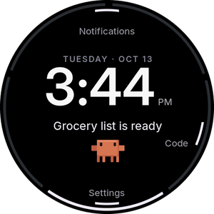 | 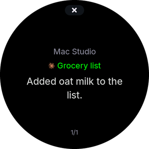 | 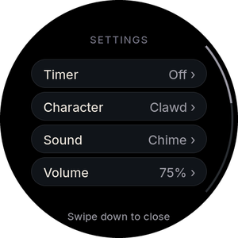 | 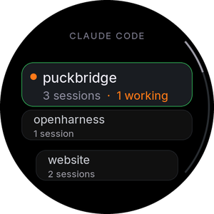 | 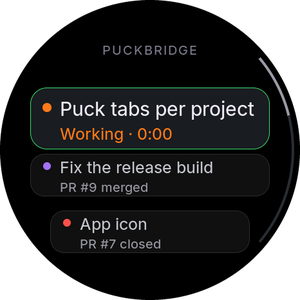 | 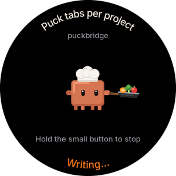 | 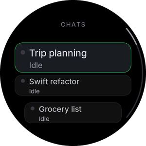 |
| **Light** | 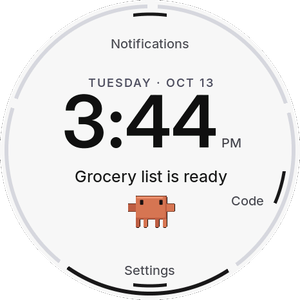 | 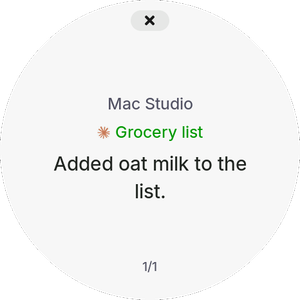 | 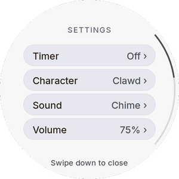 | 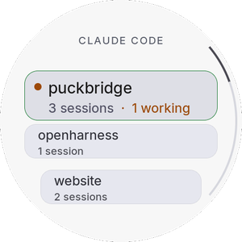 | 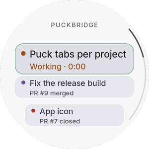 | 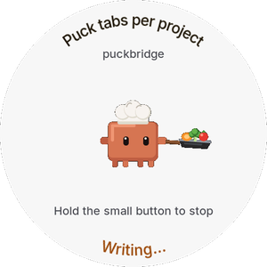 | 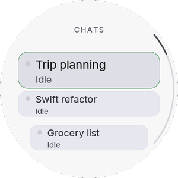 |

Three list styles (Settings → **Lists**, or on the puck): **Cards** (above), **Dial** and **Compact list**. **Appearance**: Dark, Light or Match Mac.

| Cards | Dial | Compact list |
|---|---|---|
|  | 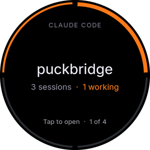 | 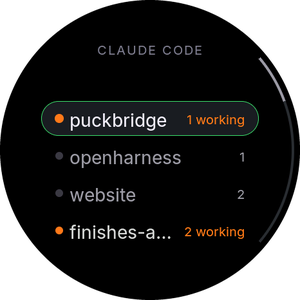 |
|  | 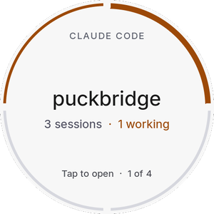 | 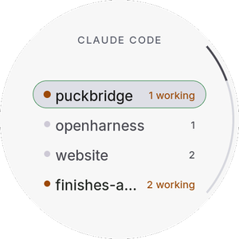 |

Timers and alarms (Puck Bridge firmware pb.7): tap the line under the clock for the timer dial, or say "timer 2 hours 15 minutes", "stop the timer", "alarm 7:30 am". Hold the face to talk; let go to send.

| Timer dial | Timer running | Alarm |
|---|---|---|
| 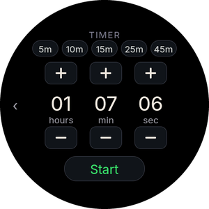 | 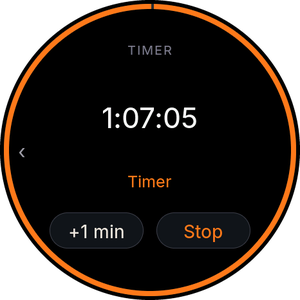 | 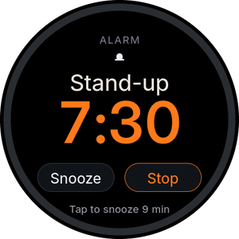 |

Session rows show what each is doing: orange **Working · 1:23**, **Reply ready**, or its pull request (**PR #9 merged** purple, **PR #12 open** green, **closed** red). To refresh these pictures: `scripts/test-firmware.sh`, then `python3 firmware/sim/tools/readme_shots.py`.

## Install on a Mac
Download **PuckBridge.dmg** from the [latest release](https://github.com/mattsinitiere/puckbridge/releases/latest), open it, and drag Puck Bridge onto Applications. The first time, if macOS says it can't check the app, open System Settings → Privacy & Security and click **Open Anyway**.

Or in Terminal:
```bash
curl -fsSL https://raw.githubusercontent.com/mattsinitiere/puckbridge/main/scripts/install.sh | bash
```
The first time it opens, a small **Set Up Puck Bridge** window walks you through the permissions one at a time (Accessibility, Speech Recognition, Location for the weather) and moves on by itself as each is switched on. Then turn on **Start Puck Bridge when you log in** in ◎ → Settings… → General.

## Update
◎ menu → **Check for updates…** (it also checks daily). Or re-run the install line.

## Puck Bridge firmware (clock, side pages, settings, sounds)
◎ → Settings… → **Puck** → **Firmware** → **Install…** puts Puck Bridge's firmware on the puck over the USB cable (about a minute; keep it plugged in). **Restore…** in the same place puts Autonomous's official firmware back. What it adds:
- **Clock-home navigation** (with the Cards, Dial or Compact list style): down = notifications, up = settings, left = Claude Code groups, left again = chats, right = back. Hold the face to talk.
- **Timers and alarms:** a timer dial (tap the line under the clock), Stop before it rings, and up to four alarms (cleared when you unplug the puck). **Classic** keeps the older side pages (Settings ← Clock → your chats).
- **Clock home screen:** big time, date, weather, your character, and a ring with one segment per chat (orange while Claude works, white when a reply is waiting). It comes up after 5 idle minutes, and the small button always goes there.
- **Settings on the puck:** character (pick from animated previews), sound, volume, brightness, calm mode, clock delay, 24-hour, weather.
- **Small button:** tap → clock · hold while Claude writes → stop.

## Try work in progress (Beta Access)
Every branch pushed to GitHub gets a preview build. ◎ → Settings… → General → turn on **Beta Access**, then **Install…** next to the branch you want. **Back to the Release…** returns to the normal version. Previews can be unfinished.

## Make a release
1. Bump `CHANGELOG.md`.
2. GitHub → **Releases → Draft a new release** → new tag like `v0.3.1` → **Publish**.
3. The *Release* workflow builds the app and attaches `PuckBridge.zip` (~3 min).

## Keep macOS permissions across updates (recommended, one-time)
Without this, every update is signed differently and macOS asks for Accessibility and Speech Recognition again.
1. Open **Terminal** and paste:
   ```bash
   curl -fsSL https://raw.githubusercontent.com/mattsinitiere/puckbridge/main/scripts/make-signing-cert.sh | bash
   ```
2. It makes a private signing certificate and opens GitHub twice. (The secrets are for the whole repository: releases, `main` and every preview get signed.) Each time, paste the name it shows and press ⌘V for the secret, then **Add secret**.
3. Install the next build (a new release, or ◎ → Check for Updates…). macOS asks for permissions **one last time**, then keeps them for every later update.

◎ → Settings… → General → **Signature** shows *Signed as Puck Bridge Signing* once this is working.

## Buttons (current official firmware)
| Button | Tap | Hold |
|---|---|---|
| Large (top) | screen on/off | hardware restart |
| Small (bottom) | back · stop Claude when writing · cancel voice | screen on/off |

The small button is the chip's BOOT button: hold it while plugging in to force flashing mode (recovery).

## Develop
```bash
scripts/dev-install.sh          # build this checkout and install it locally
tail -f ~/Library/Logs/PuckBridge.log
```

## Troubleshooting
- **"held by OpenHarness"** — the app stops OpenHarness's service automatically; to give the puck back use ◎ → Settings… → Advanced → *Lend the Puck to OpenHarness…* (and *Take It Back* later).
- **No beep when Claude finishes** — new pucks ship with the beep off: ◎ → *Beep When Claude Finishes*.
- **Chats stopped appearing after an update** — System Settings → Privacy & Security → Accessibility → toggle Puck Bridge off/on (or set up the signing certificate above).
